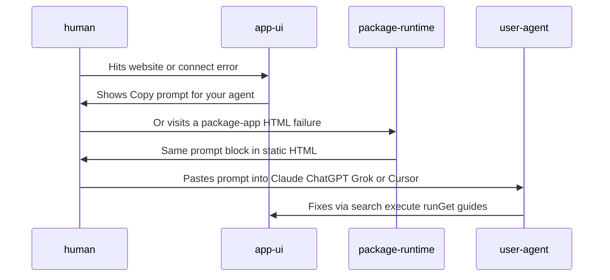

<!-- system-recap:start -->

System recap: <b>extends existing primitives</b> (medium risk)

**Mode:** recap · **Base:** `main` @ `f9a4b1508` · **Head:** `91e9dfda6`

**Classification:** extends. Shared error-prompt helper + button composed into
agent-blind website/email surfaces; no `primitives.yaml` map change.

### Primitives touched

| Primitive         | Group    | Impact  |
| ----------------- | -------- | ------- |
| `app-ui`          | surfaces | extends |
| `package-runtime` | runtime  | extends |

### Change flow

Agent-blind HTML errors get a redacted copy-paste prompt for the user's agent.

<!-- system-recap:end -->
